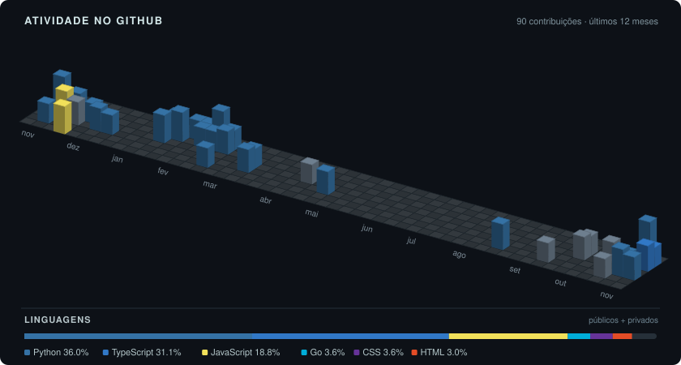

# Eduardo Diniz

Analista de software e dados · Graduado em **Sistemas de Informação** pela UNIFESSPA.

[E-mail](mailto:edumedeiros.medeiros5@gmail.com) · [Instagram](https://www.instagram.com/eduardodinniz)

### Tecnologias

**Principal:** Go · Python · Pandas · Git · Godot  
**Web:** TypeScript · JavaScript · React · WordPress  
**Dados:** PostgreSQL · MySQL · MongoDB  
**Ferramentas:** VS Code · Notion · Linux · Windows  
**Estudando:** Godot · C

### Contribuições

